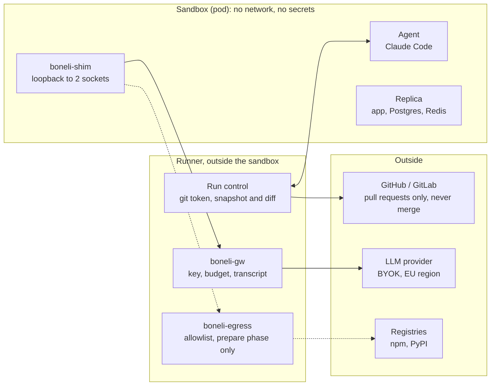
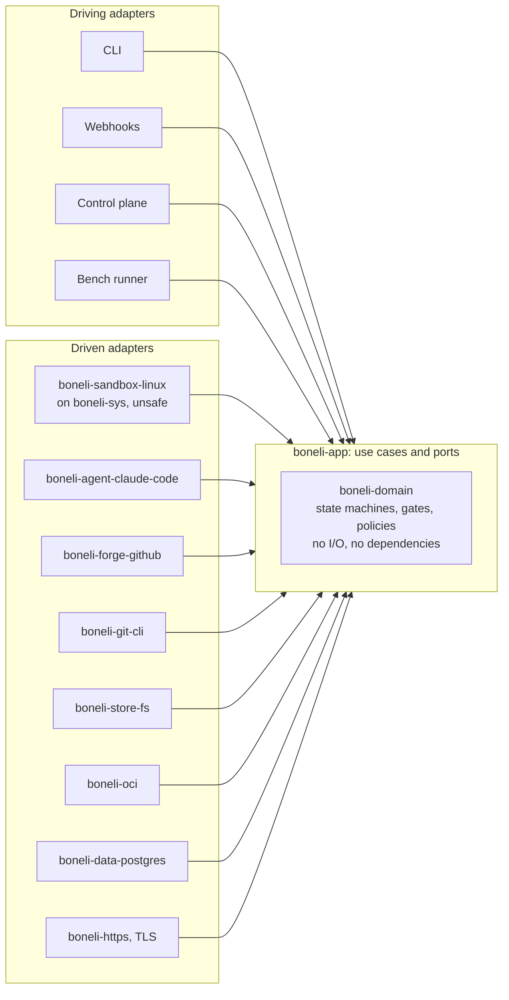

# Boneli: Architecture Proposal

Status: draft, November 2026.

## Summary

Boneli is a SaaS that, for every bug, builds a replica of the application with data, reproduces the bug in it, finds the root cause with verified evidence and opens the fix as a pull request. It is written in pure Rust using a hexagonal architecture.

- **Model:** SaaS. The control plane runs with us, the runner runs with us or inside the customer's network.
- **Isolation:** our own sandbox runtime in Rust, without gVisor or OpenShell. The sandbox has no network and no secrets; the only way out is a set of Unix sockets to brokers.
- **LLM:** Claude only for the MVP. The MVP runs Claude Code on a subscription, for our own development, benchmarks and demos only. Customers run on their own API key through the gateway; provider-agnostic routing comes later.
- **First stack:** TypeScript/Node with Postgres, then Python (Django).
- **Code:** pure Rust with minimal dependencies, a hexagonal architecture enforced by crate boundaries.
- **Benchmark:** our own and resistant to solution leakage. It measures debugging, not model memory.

## Product

Boneli sells the reproduction of a bug on the customer's data, its root cause with evidence and a tested fix, all running inside the customer's network. Existing tools (Copilot, Cursor, Devin, Sentry Seer) stop at a pull request without an environment or data.

- **Control plane** (hosted by us): UI, GitHub/GitLab App, run scheduling, configuration, metadata, gate results and billing. Multi-tenant.
- **Runner** (hosted by us or by the customer): sandbox, gateway, egress, shim and gates. It only opens outbound connections and has no open ports. Code, data, replicas, transcripts and the LLM key never leave it.
- **The runner is open source**, so customers can read what runs in their network.

| Tier | Runner | Includes | For |
| --- | --- | --- | --- |
| Base | hosted | code, replica from seed data, reproduction test, fix | smaller teams, less sensitive code |
| Pro | hybrid (hosted only with anonymized data) | plus an anonymized data snapshot | teams with data-driven bugs |
| Enterprise | hybrid | plus brokers for logs, Sentry and a SQL replica | regulated companies |

**Pricing:** a monthly fee per repository plus a fee per verified fix. Customers pay for tokens with their own key (BYOK). Public open-source repositories are free.

**Distribution:** a public benchmark, Boneli running on open-source issue trackers with the maintainers' consent, and the open-source runner.

## System parts

The system has one core and four parts on top of it. The benchmark is only a reporting layer.

| Part | What it does | Where it is used |
| --- | --- | --- |
| Core (runner) | sandbox, gateway, egress, shim, verifier | everywhere |
| Env builder | builds a replica from the repository at a given SHA and gets the baseline green | SaaS onboarding, first step of the case builder |
| Debugger | issue, reproduction, root cause, fix, pull request | the product |
| Case builder | an environment from the env builder, a bug (injected or fresh real) and a hidden oracle | benchmark, golden cases |
| Bench | runs the debugger over cases and computes metrics | development, marketing |

The env builder is the key capability. In the SaaS it decides whether onboarding works without a human, and in the benchmark it produces the cases.

## Isolation

The sandbox holds nothing worth stealing and has no way to carry anything out. It has no git token, no API key, and its only network interface is loopback. The MVP is the one exception: the subscription token lives inside the sandbox (see the next section).



Target state: during the agent phase the only way out is through the gateway to the LLM. Dashed lines are open only in the prepare phase. In the MVP, instead of the gateway, the agent goes through the egress proxy to `api.anthropic.com` only, using the subscription token. Verification runs in a new sandbox without either socket.

**Our own runtime in Rust** instead of Docker or Podman, directly on top of syscalls:

- user, mount, pid, net, ipc, uts and cgroup namespaces; root inside the container maps to an unprivileged host user (single uid mapping, no setuid helpers),
- `pivot_root` into a rootfs assembled from OCI layers, overlay and tmpfs (overlay inside a user namespace works since Linux 5.11),
- cgroups v2 through writes to `/sys/fs/cgroup`: memory, CPU, process count, IO,
- a seccomp-bpf filter assembled in Rust that additionally blocks `io_uring`, `bpf`, `userfaultfd`, `perf_event_open`, `keyctl` and new user namespaces,
- `no_new_privs`, no capabilities, a read-only rootfs; only `/workspace` and `/tmp` are writable,
- Landlock as a second layer, enabled by `boneli-shim` before it starts the agent.

**Pod.** The application and its services (Postgres, Redis) share one network namespace, each with its own rootfs. They see each other on `127.0.0.1` and nothing leads outside.

**Sockets instead of a network.** Only the brokers' Unix sockets are bind-mounted into the sandbox, and `boneli-shim` exposes them on loopback. The run's identity is the socket path, not a token that could be stolen.

**Three phases, three sandboxes:**

1. **Prepare:** egress socket with a registry allowlist, no LLM. Installs dependencies and builds into its own layer.
2. **Agent:** no network, only the gateway socket (in the MVP, the egress socket with an Anthropic-only allowlist). Dependencies are read-only.
3. **Verify:** a clean sandbox with neither network nor gateway. It gets only the base SHA and the diff.

**Residual risk.** We share the host kernel, so a kernel exploit remains possible. Mitigation: one customer per VM and, from v1, one host for sandboxes and a separate one for the gateway and the git token, so escaping a container does not yield keys.

## LLM access and egress

The MVP runs on a subscription; customers run on their own API key. We never pay for API usage ourselves.

**MVP: Claude Code on a subscription**

- The agent is the official Claude Code inside the sandbox, signed in with a token from `claude setup-token`.
- Outbound traffic only goes through the egress proxy (CONNECT) with an allowlist for `api.anthropic.com`. This is a standard corporate proxy via `HTTPS_PROXY`; we neither read nor modify the traffic.
- `CLAUDE_CODE_DISABLE_NONESSENTIAL_TRAFFIC=1`, so no telemetry leaves.
- Transcript, token usage and cost come from Claude Code's stream-json output.
- The token inside the sandbox is a known MVP exception. It can only be carried to Anthropic, and we revoke it after the MVP.
- For our own development, benchmarks and demos on open-source repositories only. The terms allow subscriptions in Claude Code, not in products offered to other people.
- Subscription limits (usage windows and a weekly cap) limit benchmark parallelism, so runs are scheduled into windows.
- If Anthropic restricts automated use of Claude Code further, we switch to an API key behind the same port.

**From the first customer: gateway and BYOK**

- The gateway holds the customer's key. The agent gets only a loopback address and a dummy key via `ANTHROPIC_BASE_URL`.
- Budget per run and per bug from the `usage` field. When it is exceeded, the gateway closes the socket and the runner kills the sandbox.
- Transcripts addressed by hash, and secret redaction in prompts.
- Routing: Anthropic, then Bedrock or Vertex in an EU region, OpenAI on customer request.

**Switching without touching the domain:** the `Agent` port has two access configurations, `Subscription` and `ApiKey`. Neither the domain nor the use cases know the difference.

**Egress proxy in the prepare phase** allows CONNECT only to registries (npm, PyPI), without MITM, and logs every connection. github.com is not on the allowlist.

## Debugging line

The line is a state machine. Every step is a job in a sandbox and every gate is deterministic: when it is not sure, it does not pass.

1. **Intake** from GitHub, GitLab, Jira or Sentry.
2. **Triage.** When information is missing, the line posts a comment with questions instead of guessing.
3. **Reproduction.** The agent writes a test. Gate: on the base SHA it runs and fails on an assertion, not on compilation.
4. **Root cause analysis** as structured output, every citation as `path:line@sha` with the quoted text. Gate: every citation is verified against the base SHA; unverifiable ones are flagged.
5. **Fix.** Gate in a clean sandbox: the reproduction test is green, previously green tests stay green, lint and typecheck per configuration, and the reproduction test is unchanged.
6. **Pull request** with the root cause, reproduction test, before and after results, cost and a link to the transcript. A human always merges.
7. **Golden cases.** A human picks closed bugs as golden cases, and the line is regression-tested against them before every change of model, prompts or configuration. Review comments are only candidates; we do not generate rules from them automatically.

**Patch policy** checks diff size, forbidden paths (CI, Dockerfile, CODEOWNERS), binaries, symlinks pointing outside and disabled tests.

**Customer standards** (a hypothesis to validate in customer interviews):

- **Source:** files in the repository (CONTRIBUTING, ADRs, CLAUDE.md, AGENTS.md, linter configuration) and pages on the web. A broker fetches the web pages at onboarding; the run gets a snapshot with a version hash. Port `Standards`, later adapters for Confluence and Notion.
- **Checkable parts** go to a deterministic gate: lint, forbidden patterns, file structure.
- **Judgment parts** are checked by a second agent in a review step. Every finding cites a specific paragraph of the standard, and the citation is verified the same way as in the root cause analysis. Findings go into the pull request; only the checkable part blocks.
- The pull request states which version of the standards the run used.

**Git.** The runner holds a short-lived token (GitHub App, GitLab project token without merge rights). The sandbox gets a snapshot without remotes, hooks or credential helpers; only the diff comes back.

## Environment and data

Inside the sandbox the agent has full control over the replica. It reaches the customer's real systems only through read-only brokers.

**The replica** is built from the repository's development setup (compose, scripts). The env builder proposes it, the runner starts it as a pod, and the baseline must be green. Development configuration replaces external services; workers and cron run as well.

**Data ladder:**

1. **Seed data from the repository** is enough for logic bugs.
2. **An anonymized snapshot** prepared on the customer's side, for Postgres for example with [Greenmask](https://dev.co/databases/open-source/greenmask).
3. **A slice for the bug:** a broker pulls the specific records from the customer's database replica, masks them and loads them into the local database.

Every bug gets a clean copy via `CREATE DATABASE bug_123 TEMPLATE snapshot`.

**Brokers** (Enterprise): SQL against a read-only replica, Sentry, logs. They enforce row limits, timeouts and column masking, and every query goes to the log and into the pull request. Credentials stay in the broker, never in the sandbox.

**Replay:** a request is reconstructed from a Sentry event, trace or access log and sent to the replica as an anonymized user. Asynchronous jobs are started from the console with the payload from the log.

**Browser:** Playwright runs only inside the sandbox, against the replica or against the customer's preview environment, with egress allowed only to its exact host. Never against an environment the line did not create.

**Data and the LLM:** whatever the agent reads goes to the LLM. Non-anonymized data is therefore only processed with the runner inside the customer's network and under the customer's own contract with the provider.

## Benchmark

The benchmark measures debugging, not whether the model remembers the fix or finds it somewhere. With popular repositories this is a real problem: OpenAI stopped reporting SWE-bench Verified in February 2026 because of contamination ([CodeSOTA](https://codesota.com/news/swe-bench-contamination-debate)).

**Leakage through the environment:**

- the repository is rebuilt only from objects reachable from the base SHA (`git init` and `git fetch` of the base SHA), with no future commits, branches or tags,
- the issue only as it was before the fix, without links to pull requests or commits, passed through an LLM and checked by hand,
- no egress during the agent phase, and no github.com even during preparation,
- tests from the fix only as a hidden oracle in the verifier,
- item validation: the hidden test fails on the base and passes with the original fix.

**Leakage through model memory:**

- only bugs fixed after the training cutoff of the measured model, with the set topped up monthly, like [SWE-rebench](https://papers.neurips.cc/paper_files/paper/2025/hash/21bec6ace947b1b58967b945c8ac0f10-Abstract-Datasets_and_Benchmarks_Track.html),
- a probe for every item: the model guesses the file and the fix from the issue text alone, without the repository; a hit means the item is dropped (the same diagnostic as [The SWE-Bench Illusion](https://arxiv.org/html/2506.12286v2)),
- less well-known repositories.

**Injected bugs:** a healthy repository, an injected bug and a report written from the application's behavior, not from the diff (the same principle as [SWE-smith](https://arxiv.org/abs/2504.21798v2)). Mainly bugs in the environment: data in the snapshot, configuration, job ordering. Calibrated against real bugs, no reverts of historical fixes.

| Set | Source | Size | Purpose |
| --- | --- | --- | --- |
| A | fresh real bugs after the cutoff from two or three repositories | small, topped up monthly | honest comparison |
| B | injected bugs in code and data | hundreds | strength of the environment |
| C | customers' golden cases, picked by hand from their closed bugs | per customer | regression and onboarding acceptance |

Golden cases go through the same case builder as the other sets. The repository is rebuilt only from the base SHA, so the fix in the customer's history stays invisible.

**Metrics:**

- **Reproduction:** the agent's test fails on the base and passes with the original fix.
- **Localization:** file and function; for data bugs, table and record.
- **Fix:** hidden tests pass, no regressions.
- **Success rate by root cause category:** code, data, configuration, runtime.
- **Cost and time** from the gateway (in the MVP, from Claude Code's output).
- **Contamination score** for set A.

## Code architecture

A hexagonal architecture with an I/O-free domain at its center. The compiler enforces the dependency rule: every layer is its own crate and dependencies point inward only.



Arrows show the direction of dependencies between crates. The domain and the application know nothing about Linux, the network or formats. All of that lives in adapters, which tests replace with in-memory ones. The gateway, egress proxy and shim (`boneli-gw`, `boneli-egress`, `boneli-shim`) are separate processes behind the security boundary and talk to the runner over Unix sockets.

- **Domain** (`boneli-domain`): types, run and case state machines, policies, gates, budget accounting. Pure functions, no I/O, no dependencies, `#![forbid(unsafe_code)]`.
- **Application** (`boneli-app`): use cases and ports as traits. Depends only on the domain.
- **Adapters** (`boneli-<port>-<impl>`): port implementations, each in its own crate on top of `boneli-app`.
- **Composition roots** (binaries `boneli-runner`, `boneli-gw`, `boneli-shim`, `boneli-cli`): wire the adapters together and start a driving adapter.

**Use cases** cover every part on top of one core: `BuildEnvironment`, `OnboardRepo`, `DebugTicket`, `BuildCase`, `RunBench`.

| Port | MVP adapter | Later |
| --- | --- | --- |
| `Sandbox` | `boneli-sandbox-linux`, our own runtime | microVM |
| `Agent` | `boneli-agent-claude-code` | own harness in Rust, Codex |
| `Forge` | `boneli-forge-github` | GitLab |
| `Git` | `boneli-git-cli` | native implementation |
| `EventStore`, `Evidence` | `boneli-store-fs`, append-only log and content-addressed storage | Postgres in the control plane |
| `ImageStore` | `boneli-oci` | |
| `DataSnapshot` | `boneli-data-postgres`, commands through the `Sandbox` port | MySQL |
| `Standards` | repository files, web pages through a broker | Confluence, Notion |
| `Broker` | | SQL, Sentry, logs |
| `Clock`, `Ids` | system | |

**Driving adapters:** CLI, webhooks, control plane connection, bench runner.

**Functional core, imperative shell.** The domain takes an event and returns a new state and a list of commands. The application executes the commands through ports and feeds the results back to the domain as events. Events go to an append-only log, so every run can be replayed and doubles as an audit trail.

```rust
pub trait Sandbox {
    fn create(&self, spec: &SandboxSpec) -> Result<SandboxId, SandboxError>;
    fn exec(&self, id: &SandboxId, cmd: &Command, limits: &Limits) -> Result<ExecResult, SandboxError>;
    fn copy_out(&self, id: &SandboxId, path: &WorkspacePath) -> Result<Blob, SandboxError>;
    fn destroy(&self, id: &SandboxId) -> Result<(), SandboxError>;
}

impl Run {
    pub fn handle(self, event: RunEvent) -> Result<(Run, Vec<RunCommand>), DomainError>;
}
```

**Ports are synchronous.** The runner runs on `std` threads, without an async runtime. That is enough for dozens of runs per runner and saves the largest dependency.

**Testing:** every port has an in-memory adapter and a set of contract tests that both the real and the in-memory adapter must pass. The domain and use cases are tested without Linux and without a network.

**Gateway, egress and shim** are separate processes because of the security boundary. The gateway and the egress proxy each have their own small hexagon: a domain (budget, routing, allowlist) and ports (upstream, transcript store).

## Pure Rust and dependencies

All code is Rust. Dependencies are guarded by an allowlist in the workspace and a CI script that fails on any crate outside it, transitive ones included.

| Crate | Why | Where it may appear |
| --- | --- | --- |
| `libc` | syscall declarations (namespaces, mount, seccomp, Landlock) | only `boneli-sys` |
| `httparse` | HTTP/1.x parsing without further dependencies | `boneli-http` |
| `rustls`, `webpki-roots`, `ring` | TLS to LLM providers, forges and registries | only `boneli-https` |
| `sha2` | content addressing, evidence | `boneli-store-fs` |
| `miniz_oxide`, `ruzstd` | unpacking OCI image layers | `boneli-oci` |

**We write ourselves:** an HTTP/1.1 server over a Unix socket and a client over TLS, a JSON parser and serializer without derive, a parser for a TOML subset for configuration, tar reading, argument parsing, structured logging, error types, RFC 3339 and ID generation.

**We do not use:** tokio, serde, clap, tracing, anyhow, rusqlite.

**Unsafe** only in `boneli-sys`; everywhere else `#![forbid(unsafe_code)]`.

**JSON without derive** fits the hexagon: the domain does not know JSON, and mapping to DTOs belongs in the adapters.

**Exceptions where pure Rust is not possible:**

- **TLS:** there is no production-ready cryptographic backend in pure Rust, and `ring` contains assembly and C. We isolate it in a single adapter.
- **Git:** in the MVP we call `git` as an external binary through an adapter. A native implementation (smart HTTP, packfiles) can come later behind the same port.
- **Agent:** Claude Code is a Node binary inside the sandbox, not part of our code. Our own harness in Rust will come as another adapter.
- **Control plane:** multi-tenant Postgres and many connections. We will choose the async runtime and the Postgres client when we get there.

## First stack: TypeScript/Node and Postgres

The core does not depend on the stack. Only the env builder and case builder adapters do.

- **Tests:** running a single test through jest or vitest with a JUnit reporter.
- **Database:** preparation through Prisma, TypeORM or SQL migrations.
- **Seeds:** the basis of the data replica and of injecting data bugs.
- **Replay:** signing in as a specific user according to the application's auth library.

**Candidate repositories** for the env builder and set A: Cal.com, Twenty, Documenso. For each, verify the license, a compose-based dev setup, tests from the command line and an active issue tracker. n8n only after reading its fair-code license, which restricts commercial use.

**Second stack:** Python (Django) with Postgres, once onboarding on TypeScript works.

## Plan

First one demo of the whole chain, then automation. We do not build a case factory before we know what the debugger can handle.

1. **Core:** `boneli-domain`, `boneli-app`, `boneli-sys`, the sandbox runtime, the shim and the egress proxy. Demo: Claude Code on a subscription in a sandbox on a TypeScript repository with Postgres in the pod; tests pass and `curl` to the outside fails.
2. **Env builder by hand:** environment configuration for three repositories and a green baseline.
3. **Env builder as an agent:** it proposes the configuration itself. Metric: how many of 20 open-source TypeScript repositories reach a green baseline on their own.
4. **Five to ten hand-injected bugs**, half in code, half in data.
5. **Debugger v0** through Claude Code and the gates. Demo: an injected data bug; the line finds it and opens a pull request with evidence.
6. **Automated case builder and benchmark**, calibrated against real bugs.
7. **Control plane** and the first hosted runner.

The key SaaS number is the share of repositories that pass onboarding without a human. Below half, self-serve does not work.

## Risks and open questions

The main risk is technical: whether onboarding works without a human. Step 3 of the plan measures it.

- **Well-funded competition** (Sentry, GitHub, Cursor) can build reproduction environments too. Defense: data, the hybrid runner, evidence.
- **Our own runtime** is more work than Podman, and a bug in it is a security bug. It needs a red-team suite and fuzzing of the seccomp and mount logic.
- **TLS and git** are not pure Rust. The exceptions are isolated in adapters.
- **Data liability:** a DPA with customers, professional liability insurance and a proper legal entity.
- **Repository licenses** for the benchmark and published results.
- **Open:** the async runtime and database for the control plane, when to add the second stack, when to replace Claude Code with our own harness, and whether customers want to connect their own standards.

## Sources

- [Agent SDK overview (Claude Code Docs)](https://code.claude.com/docs/en/agent-sdk/overview)
- [Is SWE-bench Verified Contaminated? (CodeSOTA)](https://codesota.com/news/swe-bench-contamination-debate)
- [The SWE-Bench Illusion (arXiv)](https://arxiv.org/html/2506.12286v2)
- [SWE-rebench (NeurIPS 2025)](https://papers.neurips.cc/paper_files/paper/2025/hash/21bec6ace947b1b58967b945c8ac0f10-Abstract-Datasets_and_Benchmarks_Track.html)
- [SWE-smith (arXiv)](https://arxiv.org/abs/2504.21798v2)
- [Greenmask (DEV.co)](https://dev.co/databases/open-source/greenmask)
